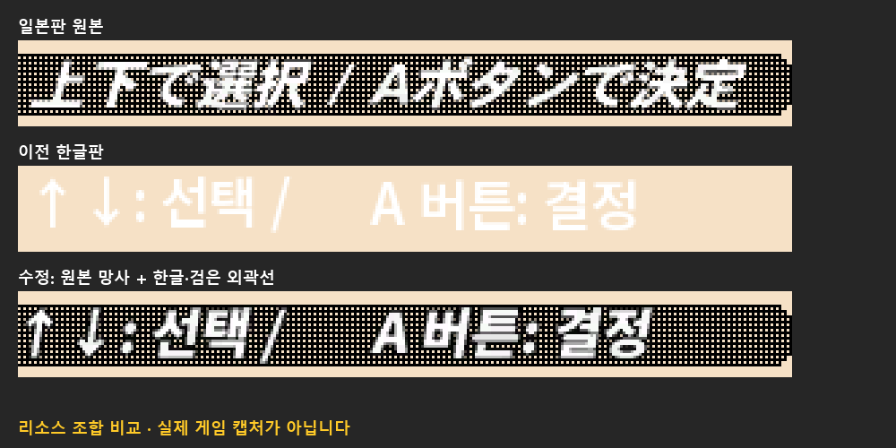
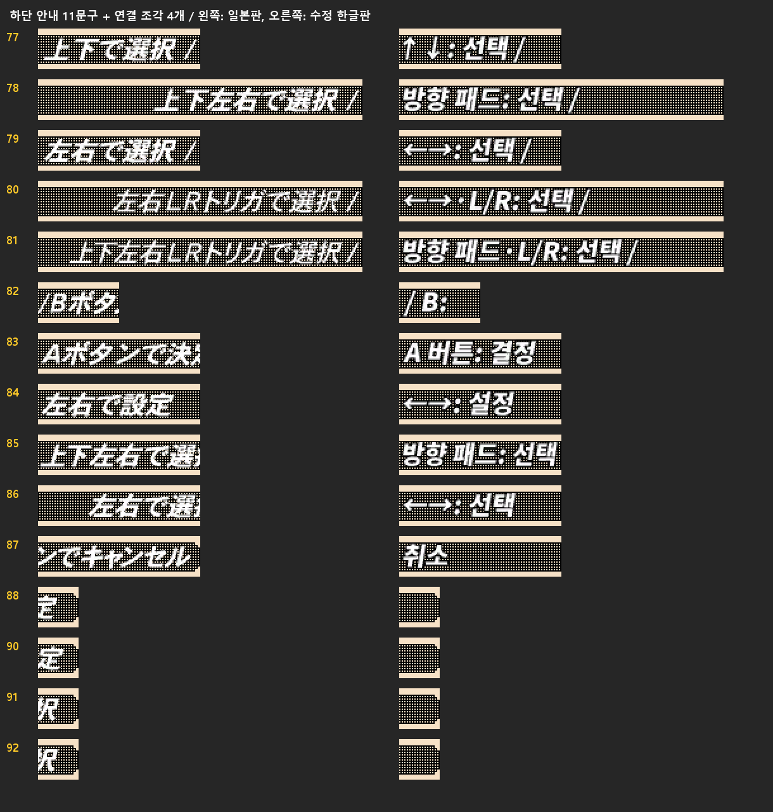

# V1.0.2 하단 안내바 수정

메뉴 아래쪽에 망사 조각만 남고 흰 안내 문구가 밝은 배경에 묻히던 문제를 수정했습니다.

## 일본판과 비교한 결과

망사는 일본판 원본의 안내바 패턴입니다. 원본 `tSprites.art`의 89번 리소스는 글자가 없는 망사 끝 조각이며, 기존 한글판도 이 조각은 원본과 바이트 단위로 같았습니다. 반면 안내 문구를 한국어로 바꾼 리소스에서는 망사 배경을 없앴기 때문에 조각만 따로 보였습니다.

V1.0.2는 이 원본 조각의 글자 없는 영역에서 패턴을 가져와 문구 밑에 복원했습니다. 일본어 글자 픽셀을 재사용하지 않아 지운 글자의 잔상이 남지 않습니다.

위 이미지는 리소스 조합 비교이며 실제 게임 캡처가 아닙니다.

## 모두 같은 방식으로 적용

- 방향 선택, A 결정, B 취소, 좌우·L/R 선택·설정 안내 **11개 문구**
- 문구 끝에 이어지는 **4개 연결 조각**의 망사와 둥근 끝부분
- 원본과 같은 망사 높이·패턴 간격·투명도 위상
- 동일한 글자 크기와 기준선, 흰 글자와 검은 외곽선
- 긴 문구는 높이를 줄이지 않고 가로 폭만 조절해 원래 칸 안에 배치

## 검수 범위

기존 V1.0/V1.0.1 게임 파일 401개와 비교했을 때, 변경 파일은 `Media/Sprites/tSprites.art` 하나입니다. 그 안의 안내 문구·연결 조각 15개만 바뀌었습니다. 아카이브 길이, 텍스처 크기·형식·인덱스·메모리 할당량은 유지했습니다. 89번 원본 망사 조각도 그대로입니다.

기존 XBE 실행 코드, 한글 폰트 아틀라스, 다른 그래픽, 음악·가사 내용은 바꾸지 않았습니다. 일본판 원본 ISO도 보존했습니다. 실기 플레이 검증은 수행하지 않았습니다.

- [망사·외곽선·변경 범위 검수](menu-verification-1.0.2.json)
- [실제 EXE 적용·결과 해시·원본 보호 검수](patcher-verification-1.0.2.json)
- [배포 EXE의 Defender 검사 기록](antivirus-check-1.0.2.json)

수정 EXE는 **일본판 원본 ISO**에 적용합니다. 이미 한글화한 ISO에 덧씌우는 패처가 아닙니다.
